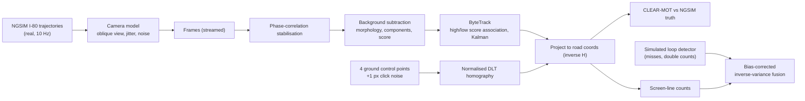
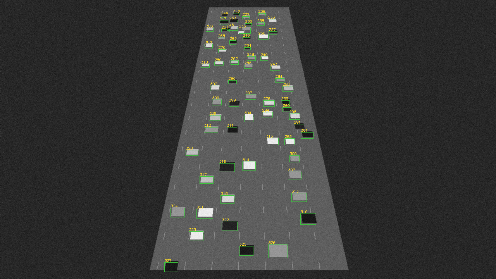
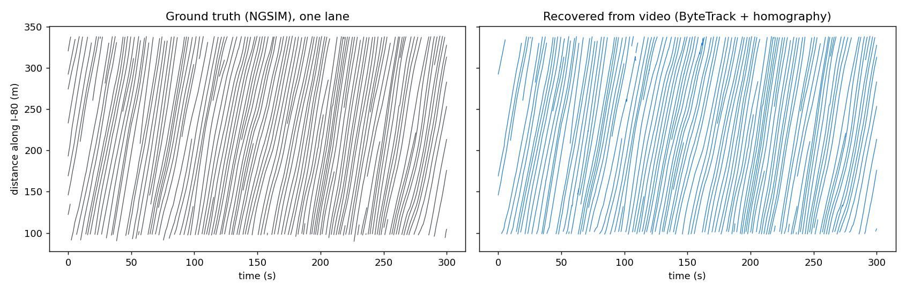

# drone-trajectory-video-fusion

**From drone video to georeferenced vehicle trajectories, scored against ground truth.** A camera
model renders real NGSIM I-80 trajectories into an oblique drone view (with hover jitter and
pixel noise). The pipeline then works only from the pixels: it calibrates a DLT homography from
ground control points, stabilises each frame, detects vehicles by background subtraction, tracks
them with a from-scratch ByteTrack, projects tracks back to road coordinates and scores them with
CLEAR-MOT against the NGSIM truth. Video counts are then fused with a simulated loop detector.

**Headline (300 s, 3,000 frames, 766 vehicles):** MOTA **0.942**, precision/recall **0.998 / 0.944**,
position RMSE **0.30 m** in road coordinates, homography check-point error **0.62 m**. Video counts
beat the loop detector (RMSE 0.89 vs 1.91 veh per 10 s), and **the fused estimate (1.24) was worse
than video alone**, which is the most useful finding here (Section 4.3).

> **What this is and is not.** The video is *rendered* from real trajectories, not real footage, so
> ground truth is exact and every error can be traced. That makes it a test bench for the geometry,
> tracking and fusion code. Real footage needs a learned detector: a `YoloDetector` adapter is
> included but **not exercised** here (no labelled footage or GPU).

---

## 1. Problem formulation

Drone video is now a routine data source for corridor studies, safety analysis (it feeds SSAM-style
conflict tools) and model calibration. The engineering questions are always the same: how accurate
is the georeferencing, how many vehicles does the tracker lose or swap, and can video counts be
trusted against, or combined with, the agency's loop detectors?

| Bar | Here |
|---|---|
| **Traffic engineering** | Georeferenced trajectories from video, time-space diagrams, screen-line counts vs loop detector, count fusion |
| **ML / CV** | Background subtraction with phase-correlation stabilisation, ByteTrack two-stage association with Kalman prediction, CLEAR-MOT evaluation |
| **Systems** | Two-pass streaming render (constant memory; the first in-memory version needed 2.8 GB), normalised DLT, FastAPI georeferencing service, Docker |

---

## 2. Architecture



---

## 3. Methodology

**Camera and homography.** A pinhole camera at altitude looks obliquely down the I-80 study section.
The road plane maps to the image by a homography $\mathbf x' \sim H\mathbf x$. $H$ is estimated by the
normalised DLT (Hartley conditioning, SVD) from four ground control points whose pixel positions are
perturbed by 1 px "click noise", and checked on separate check points.

**Detection.** The background is the per-pixel median over early frames. Each frame is first aligned to
it by phase correlation (drone hover jitter shifted lane markings by 1-2 px and produced 103 false
positives in a three-vehicle test before this step was added), then differenced, thresholded, cleaned
with morphology and split into connected components. The score is the blob fill ratio times an aspect
prior, so fragments and merged blobs score low.

**Tracking (ByteTrack, Zhang et al. 2022).** Constant-velocity Kalman prediction; first association of
high-score detections by IoU (Hungarian), then a second association of the remaining tracks with
*low-score* detections, which keeps tracks alive through partial occlusion; unmatched tracks are kept
for a short buffer before being dropped.

**Evaluation.** Tracks and truth are matched per frame in road coordinates within a 3 m gate:
$\text{MOTA} = 1 - \frac{\sum_t (FN_t + FP_t + IDSW_t)}{\sum_t GT_t}$.

**Count fusion.** Both sensors count crossings of a screen line at $y$ = 220 m in 10-s intervals. The
loop model has random misses and double counts. The first half of the intervals estimates each sensor's
bias and error variance; the second half tests
$\hat q = w\,(q_{video}-b_{video}) + (1-w)\,(q_{loop}-b_{loop})$, with $w = \sigma^{-2}_{video}/(\sigma^{-2}_{video}+\sigma^{-2}_{loop})$.

---

## 4. Results ([`results/i80_drone/RESULTS.md`](results/i80_drone/RESULTS.md))



### 4.1 Georeferencing and tracking

| Stage | Result |
|---|---|
| Homography from 4 GCPs (1 px click noise) | reprojection 1.31 px; check-point error **0.62 m** |
| MOTA | **0.942** |
| Precision / recall | 0.998 / 0.944 |
| ID switches | 113 (766 vehicles) |
| Position RMSE (matched, road coordinates) | **0.30 m** |
| Detection / tracking time | 76.0 / 8.5 ms per frame (CPU) |

* **Recall, not precision, limits MOTA.** Almost every detection is a real vehicle (0.998). The misses
  are mostly vehicles merged into one blob in dense queues, which background subtraction cannot
  separate. That is the failure a learned detector would fix.
* **ID switches matter for downstream use.** 113 switches over 766 vehicles, mostly where merged blobs
  split again. For trajectory products (car-following calibration, SSAM), short fragments should be
  re-linked or filtered first.
* **0.6 m georeferencing error even with careful GCPs.** Adequate for lane assignment, speeds and counts;
  marginal for sub-metre conflict measures, which is worth checking before feeding video trajectories to a
  safety tool.

### 4.2 Time-space diagram (one lane)



The recovered trajectories reproduce the stop-and-go waves in the NGSIM truth; fragments are visible
where tracks broke.

### 4.3 Count fusion (30 intervals of 10 s; first half calibrates, second half tests)

| Estimate | Total (truth 707) | RMSE per interval (veh) |
|---|---|---|
| Loop detector | 660 | 1.91 |
| Video | 677 | **0.89** |
| Fused (video weight 0.11) | - | 1.24 |

**Fusion made things worse, and the reason matters.** With only 15 calibration intervals, the variance
estimates were noisy enough that the method gave video a weight of 0.11, even though video was the better
sensor on the test half. Inverse-variance fusion is optimal *when the variances are known*. Estimated from
a handful of samples, it can do worse than the best single sensor. In practice: calibrate over hours, not
minutes; shrink the variance estimates; and check the fused estimate against the better sensor before
replacing it. (The unit test confirms that fusion beats a biased loop when the calibration sample is large.)

---

## 5. Layout, reproduce, limitations

```
src/dronefusion/geometry.py   normalised DLT, projection, reprojection error
src/dronefusion/render.py     camera model, NGSIM loader, background, streaming renderer
src/dronefusion/detect.py     background-subtraction detector (+ stabilisation), YOLO adapter (not exercised)
src/dronefusion/bytetrack.py  ByteTrack (two-stage IoU association, Kalman)
src/dronefusion/pipeline.py   calibration, two-pass run, CLEAR-MOT, count fusion
src/dronefusion/report.py, api/app.py (/v1/homography, /v1/georeference), cli.py
tests/ (5 tests: DLT recovery, tracker identity through low-score frames, render-detect-track end to end,
        fusion vs biased loop, API)
```

```bash
python -m venv .venv && .venv/Scripts/activate
pip install -r requirements.txt && pip install --no-deps -e .
pytest
# needs the NGSIM I-80 pages downloaded by cloud-trajectory-etl-geh-pipeline
dronefusion run --raw ../cloud-trajectory-etl-geh-pipeline/data/raw/i80_1600
docker build -f docker/Dockerfile -t dronefusion . && docker run -p 8000:8000 dronefusion
```

**Limitations.** Rendered video (no shadows, occlusion by trees or bridges, lighting change or lens
distortion); vehicles drawn as rectangles; a planar road; background subtraction cannot split merged
vehicles; the YOLO path is untested; the loop detector is a statistical model, not real loop data.

## License

MIT
