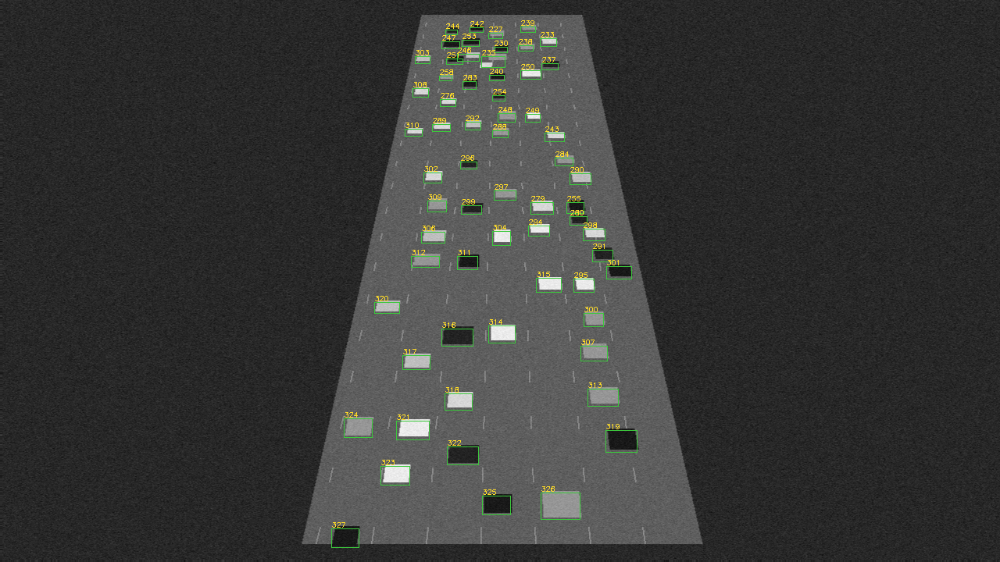
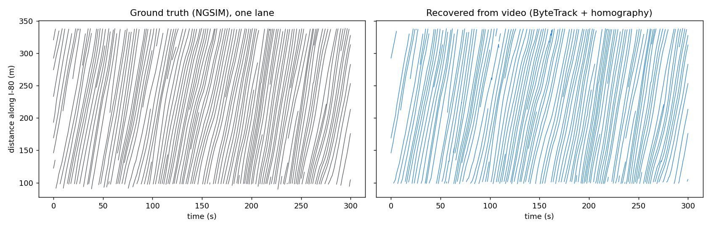

# Drone pipeline results (NGSIM I-80, rendered oblique view)

3000 frames (10 Hz), 766 vehicles in view; 62.8 detections per frame.

| Stage | Result |
|---|---|
| Homography from 4 GCPs (1 px click noise) | reprojection 1.31 px; check-point error 0.62 m |
| MOTA | 0.942 |
| Precision / recall | 0.998 / 0.944 |
| ID switches | 113 |
| Position RMSE (matched, road coordinates) | 0.30 m |
| Detection / tracking time | 76.0 / 8.5 ms per frame |

## Count fusion at y = 220 m (30 intervals of 10 s; first half calibrates, second half tests)

Totals: truth 707, video 677, loop 660.

| Estimate | RMSE per interval (veh) |
|---|---|
| Loop detector | 1.91 |
| Video | 0.89 |
| Fused (bias-corrected, inverse variance; video weight 0.11) | 1.24 |

